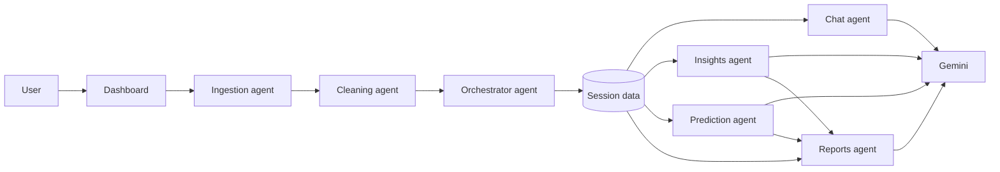

**Author:** Anisha Jangir,Anjali Sharma,Aanchal Sharma, Babita Sharma
**College:** Govt. Mahila Engineering College, Ajmer

# AI Autonomous Data Analytics Multi-Agent System

Upload any dataset (or fetch one from an API) and let a team of agents clean it, analyse it,
chat about it, explain it, predict from it and write a report. Built with Streamlit, pandas,
scikit-learn and Google Gemini.

## Features

| Page | What it does |
|---|---|
| **Dashboard** | Load a file (CSV, Excel, JSON, XML, Parquet, PDF, TXT, ZIP) or call an API. Shows rows, columns, missing values and duplicates. Runs the cleaning agent or the full orchestrator. |
| **Data Analysis** | Descriptive statistics and correlations. |
| **AI Chat** | Ask questions in plain language. Simple questions are answered from a dataset summary; calculations and charts are done by Gemini-written pandas code that runs in a restricted sandbox. |
| **Insights** | Facts are computed with pandas, then Gemini explains them (key findings, data quality issues, recommendations). Works on any dataset, with an optional target column. |
| **Prediction** | Auto machine learning: picks classification or regression, trains 3 models, compares them, shows feature importance, makes predictions and exports the best model. |
| **Reports** | Builds a Word (.docx) report: executive summary, data overview, cleaning summary, data quality, statistics, charts, model results and AI insights. |

## Architecture



Design rule: numbers are always computed with pandas or scikit-learn. Gemini only explains them,
so it does not invent statistics.

## Project structure

```
App.py                      Streamlit app and navigation
agents/
  ingestion_agent.py        any file / API / zip -> DataFrame
  cleaning_agent.py         data cleaning
  orchestrator_agent.py     runs the agents in order and logs decisions
  chat_agent.py             Gemini chat + sandboxed code runner
  insights_agent.py         dataset profiling, auto charts, AI findings
  prediction_agent.py       auto machine learning
  reports_agent.py          Word report builder
requirements.txt
.env                        your API key (not committed)
```

## Setup

```bash
python -m venv .venv
.venv\Scripts\activate          # Windows
pip install -r requirements.txt
```

Create a `.env` file in the project folder:

```
GEMINI_API_KEY=your_key_here
# optional, comma separated, tried in order
# GEMINI_MODEL=model-one,model-two
```

Run:

```bash
python -m streamlit run App.py
```

## Known limitations

- **Chat code runs in a Python-level sandbox, not an OS-level one.** The code is checked as a syntax
  tree, uses a tiny set of built-in functions, works on a copy of the data and is stopped after
  20 seconds. This greatly reduces risk but is not a full sandbox. Run the app on your own machine.
  Before any public deployment, run the generated code in a separate container or process.
- Very large datasets: prediction trains on a random sample of up to 50,000 rows.
- AI text is based only on computed statistics, but should still be reviewed before important decisions.
- Feature importance shows which columns help the prediction, not what causes the outcome.

## Tech stack

Python, Streamlit, pandas, NumPy, matplotlib, scikit-learn, python-docx, Google Gemini (`google-genai`).